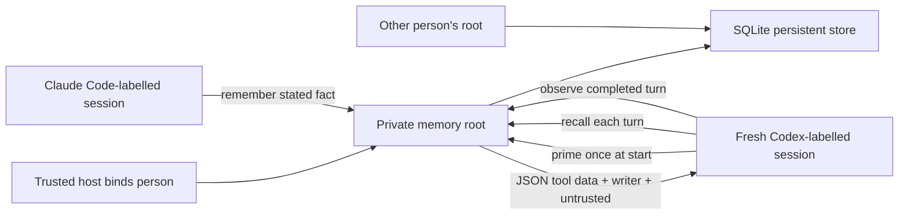

# Cross-harness memory

Keep explicitly stated preferences in a private store that survives switching agent harnesses. A Claude Code-labelled session records a synthetic travel preference; a fresh Codex-labelled session primes its context, searches the same person's memory, and observes its completed turn. Another person's private root remains inaccessible through that bound scope.

The runnable example uses Python and SQLite, with **deterministic functions in place of language models**. The harness labels illustrate switching runtimes; this program does not launch or log into either runtime. No external service, API key, or account is needed for the example.

## Run

Python 3.10 or newer; no third-party dependencies.

```powershell
python -B -m unittest discover -v
python -B demo.py
python -B demo.py --person other-person
python -B web.py --port 8885
```

Open <http://127.0.0.1:8885/>. Search for `vegetarian dinner Kyoto`, switch the synthetic identity, and inspect the lifecycle evidence. `/api/demo` returns that evidence as JSON. Each web request creates and discards a fresh private SQLite file, so browsing does not retain information. The web form changes only the demo's synthetic identity; it is not an authentication system.

For persistent local experimentation, use `python -B demo.py --db memory.sqlite`. It idempotently seeds the two facts and appends new completed-session episodes on each execution. Keep this file private; `.gitignore` excludes SQLite databases. The demonstration does not extract facts automatically: facts are remembered explicitly, and raw turns become episodes.

## Architecture



The store adds the bound memory identity to every query and validates that its owner matches. The Python simulator is trusted host code: it supplies the writer identity/type and never exposes these parameters as model tools. This is not API authentication or protection against a local Python caller that can edit the program. All returned records retain their writer and `trust: untrusted`; JSON tool content keeps recalled text out of instruction fields. This is a data boundary, not a guarantee that a language model will resist malicious text. No language model is used or evaluated here.

Prime loads only explicitly marked standing facts at session start. The human traveler sets the standing preference; the Claude Code-labelled writer keeps a separate ordinary fact. An agent writer cannot set a standing preference. Recall uses token overlap and reports `query:lexical_only` in `degraded`; it is not semantic search. A no-match result abstains. Observe saves both roles after a successful answer and deduplicates an observation retried with the same session/turn identity. Failed answers are not recorded as completed turns.

## CODE MAP

| File | Responsibility and connection |
|---|---|
| `store.py` | SQLite persistence, host-bound private scopes, explicit facts, lexical recall, standing prime, deduplicated episodes. Used by `demo.py` and `lifecycle.py`. |
| `lifecycle.py` | Session lifecycle and JSON tool-data envelope; primes once, recalls each turn, observes only completed answers. |
| `demo.py` | Synthetic fixtures, two harness-labelled sessions, deterministic answerer, and CLI. |
| `web.py` | Loopback threaded HTTP preview and JSON evidence; calls `run_demo` in a temporary store on each request. |
| `uhp_client.py` | Separate optional HTTP client for four actual UHP Memories routes; no credentials or live service are bundled. |
| `test_memory.py` | Isolation, persistence, lifecycle, data fencing, idempotency, validation, actual HTTP request shapes, pending jobs, redirects, errors, and preview concurrency. |
| `requirements.txt` | Documents the standard-library-only runtime. |
| `.gitignore` | Excludes caches, virtual environments, credentials, and generated databases/artifacts. |

## Optional real UHP client

The interface comes from [HarnessRouter](https://github.com/HarnessRouter/harnessrouter), whose [UHP Memories specification](https://github.com/HarnessRouter/harnessrouter/blob/18fbbda7f7ca98338c286437e40965ee27d7db81/protocol/versions/2026-10-19/memories.md) was checked at revision `18fbbda7f7ca98338c286437e40965ee27d7db81`. `uhp_client.py` sends these documented routes:

| Method | Route | Purpose |
|---|---|---|
| `prime` | `GET /v1/memories/{id}/prime?budget=…&depth=0` | Standing records at session start. |
| `recall` | `POST /v1/memories/{id}/recall` | Search with `query` and `limit`. |
| `remember` | `POST /v1/memories/{id}/records` | Explicit fact with string content; idempotency key required by this client. |
| `observe` | `POST /v1/memories/{id}/observe` | Role-labelled episode; a returned asynchronous job remains pending. |

Configure your own running instance, connected memory provider, restricted private memory, grants and API key first. The API key must belong to the intended caller: passing a memory ID grants no access. For example, in your own Python application:

```python
import os
from uhp_client import UHPClient

memory = UHPClient(os.environ["HARNESS_BASE_URL"],
                   os.environ["HARNESS_API_KEY"],
                   os.environ["HARNESS_MEMORY_ID"])
print(memory.recall("vegetarian dinner"))
```

Use a base URL such as `http://127.0.0.1:3000/api/harness` for an existing local instance. Remote URLs require HTTPS. Credentials use an Authorization header, redirects are refused, errors omit response bodies, and writes are never retried automatically. Keep environment values outside this repository. Handle the returned records as untrusted data with their provenance. This client returns raw results; it does not automatically run models, poll jobs, or bind the local `Session` class to a remote provider.

## Verification and limits

Tests exercise a real local HTTP server to verify the client's request methods, paths, headers and JSON payloads against the documented contract; that server is a test double, not HarnessRouter. A real HarnessRouter installation, native Claude Code/Codex sessions, Mem0/Graphiti/Hindsight/ReMe, API authentication, extraction quality, model injection resistance, and live provider behavior were **not tested**.

The SQLite example is an application-owned memory backend. It does **not** advertise UHP conformance or implement the complete memory server/provider interface, tree inheritance, grants, record revision/history, graph traversal, consolidation, semantic ranking or erasure. It is a compact way to understand persistence and lifecycle boundaries before integrating a full service.
